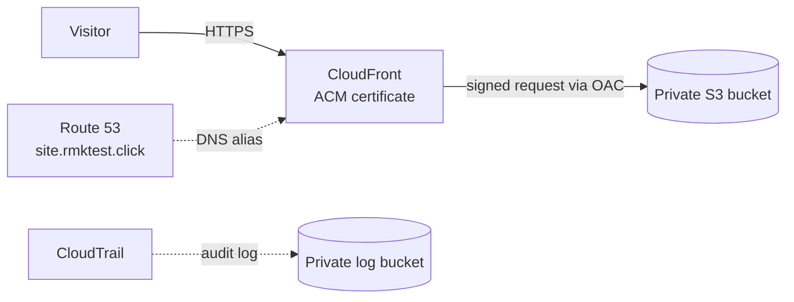
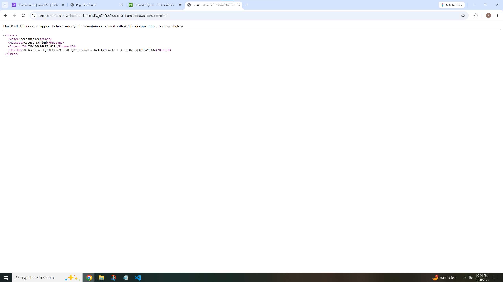

# Secure Static Website on AWS

A simple static website on AWS, built in a secure way: private storage, HTTPS, and audit logging. The website itself is one CloudFormation template, so I can delete it and rebuild it whenever I want. The certificate, hosted zone, and CloudTrail are set up separately.

**Live site:** https://site.rmktest.click

## Architecture

## What it does

- Serves a static site from a private S3 bucket through CloudFront
- Redirects HTTP to HTTPS with a free ACM certificate (TLS 1.2 minimum)
- Runs on a custom domain through a Route 53 alias record
- Builds everything with CloudFormation. The domain, certificate ARN, and hosted zone ID are parameters, so nothing account-specific lives in this repo.

## Security choices

- **Private bucket:** Block Public Access is on. Only CloudFront can read the files, using an Origin Access Control and a bucket policy locked to one specific distribution.
- **Encryption:** S3 encrypts files at rest, and CloudFront encrypts traffic in transit.
- **Audit logging:** A multi-region CloudTrail trail writes to a private bucket with log file validation on.
- **Account basics:** MFA on the root user and my IAM user, a monthly budget alert, and day-to-day work done as an IAM user instead of root.
- **Certificate:** I used a non-exportable ACM certificate. The exportable option costs extra, and CloudFront doesn't need it.

## Delete and rebuild test

I deleted the whole stack, then rebuilt it from `template.yaml` alone.

| Step | Time |
|---|---|
| Delete the stack | about 3 minutes |
| Rebuild the stack | about 5 minutes |

The certificate and domain live outside the stack, so the rebuild just reuses them. I re-upload the site files after each rebuild.

## Proof the bucket is private

If you open a file's S3 URL directly, you get Access Denied. Only CloudFront can fetch it.

## Cost

- Route 53 hosted zone: about $0.50/month
- ACM certificate: free
- CloudTrail (first trail, management events): free, plus pennies for log storage
- S3 and CloudFront: under $1 so far, as of Oct 29

## Lessons learned

- **My audit log was failing silently.** CloudTrail still showed "on," but it was writing to a bucket I'd deleted during cleanup. I made a new log bucket and turned on log file validation. Event history covered the last 90 days, but the permanent log had a gap.
- **Labs used public buckets, this doesn't.** My course labs made the website bucket public. Here the bucket stays locked and CloudFront is the only way in.
- **Read the checkbox before you click.** "Allow export" on the certificate form would have cost about $86 for this certificate. The default is free.
- **Build in small pieces.** I did the bucket first, then CloudFront, then the custom domain, so each mistake was easy to find.
- **CloudFront caches pages.** After I fixed a link and re-uploaded the file, the live site kept serving the old version until I created an invalidation.
## How to deploy

1. Create an ACM certificate in us-east-1 that covers your site name.
2. Have a Route 53 hosted zone for your domain.
3. Create a CloudFormation stack from `template.yaml` and fill in `SiteDomain`, `CertificateArn`, and `HostedZoneId`.
4. Upload the files in `site/` to the new bucket.

## Next steps

- Move the CloudTrail trail into the template
- Automate uploads so deploys don't need the console
